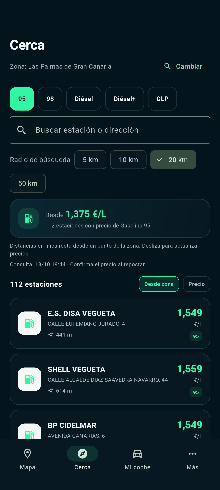

# Surtio

Compara precios oficiales de combustible en España y encuentra dónde repostar. Una app Flutter con mapa, búsqueda por municipio, favoritos y perfil de vehículo.

> En desarrollo y preparación de beta. Todavía no está publicada en Google Play.

## La app

- Mapa y lista de gasolineras con selección compartida de combustible y zona.
- Búsqueda por estación o dirección y radios de 5, 10, 20 y 50 km en la lista.
- Ordenación por precio o distancia en línea recta.
- Radio compartido entre mapa y lista, con zona manual y radio recordados entre sesiones.
- Hora de consulta visible y actualización manual de precios.
- Detalle de estación, histórico cuando está disponible, navegación y compartir.
- Favoritos y perfil de vehículo guardados en el dispositivo.
- Selección manual de municipio sin conceder acceso a ubicación.

<p>
  
</p>

Captura del recorrido de prueba en Android con datos oficiales; los precios mostrados corresponden al momento de la consulta.

## Ejecutar en desarrollo

Necesitas Flutter con Dart compatible con `pubspec.yaml`, Android SDK y un dispositivo o emulador. La versión de Flutter utilizada se puede consultar en `.github/workflows/flutter.yml`.

```sh
flutter pub get
flutter run
```

La conexión a Internet es necesaria para consultar los datos y cargar el mapa. La ubicación es opcional. Android es la plataforma de lanzamiento prioritaria; las demás plataformas no tienen validación equivalente.

## Comprobar cambios

```sh
dart format --output=none --set-exit-if-changed lib test integration_test
flutter analyze
flutter test
```

La prueba de integración en `integration_test/beta_smoke_test.dart` requiere un dispositivo Android y conexión a los servicios oficiales.

## Datos y precisión

Los precios proceden del servicio público de carburantes del Ministerio competente en España. Pueden cambiar entre la consulta y el repostaje. Las distancias mostradas son en línea recta, no distancias por carretera. El histórico depende de la disponibilidad de la fuente; no se inventan precios cuando faltan datos.

## Estructura

- `lib/app`: navegación y tema visual.
- `lib/core`: ubicación, combustible, favoritos y acciones compartidas.
- `lib/features`: mapa, lista, detalle, vehículo y ajustes.
- `test`: pruebas de comportamiento.
- `docs`: privacidad, ficha de tienda y preparación de la beta.

## Contribuir y comunicar fallos

Consulta [CONTRIBUTING.md](CONTRIBUTING.md). Para incidencias privadas o dudas: support@jvrlabs.es. No publiques claves, contraseñas ni datos personales en las issues.

## Compilación para Google Play

Consulta [la preparación del lanzamiento](docs/launch-readiness.md) y `scripts/build-play-bundle.sh`. Las claves de firma y `android/key.properties` son privados y deben mantenerse fuera de Git. El repositorio no contiene una clave de firma pública de desarrollo para versiones de lanzamiento.
